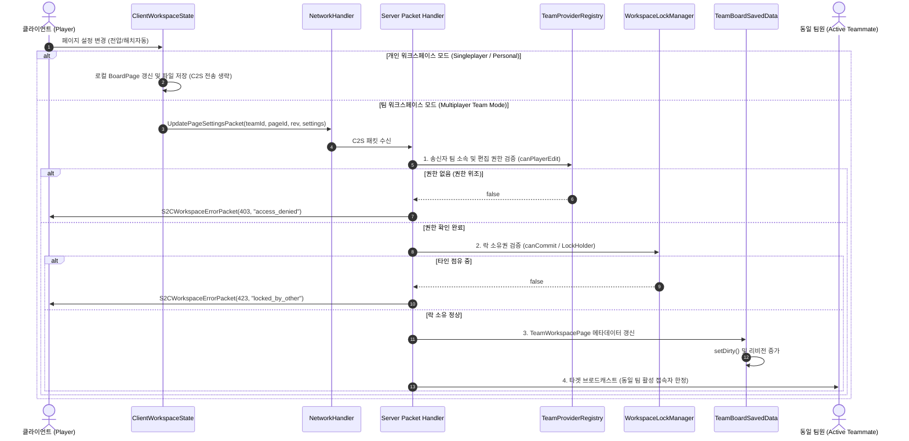

# ADR-066: 페이지 설정 네트워크 보안 검증 및 팀 워크스페이스 격리 명세
# (Page Settings Network Security Verification & Team Workspace Isolation Specification)

- **문서 번호**: ADR-066
- **대상 버전**: `v2.4.1`
- **상태**: IMPLEMENTED
- **결정 일자**: 2026-10-07
- **주관 계층**: Network (`network.packet.c2s`), Server Storage (`server.storage`), Team Core (`server.team`, `client.team`), Client GUI (`client.gui.dialog`)
- **연관 사양서**: [04. 멀티플레이어 및 네트워크](../../docs/ko_kr/spec/04_MULTIPLAYER_AND_NETWORK_PROTOCOL.md), [01. 코어 도메인 모델](../../docs/ko_kr/spec/01_CORE_DOMAIN_AND_MODELS.md)
- **선행 ADR**: [ADR-003](./ADR_003_MULTIPLAYER_NETWORK_INTEGRITY_AND_SYSTEM_STABILIZATION.md), [ADR-048](./ADR_048_PAGE_TARGET_VOLTAGE_AND_MULTIBLOCK_ENERGY_HATCH_PROVISIONING.md)

---

## 1. 개요 및 배경 (Context & Motivation)

### 1.1 현황 및 취약점 분석
`v2.4.1`에서 페이지 단위 목표 전압 티어 프로비저닝(ADR-048)을 멀티플레이어 환경에서 동기화하기 위해 `UpdatePageSettingsPacket`이 도입되었습니다. 그러나 기존 패킷 처리 파이프라인에는 다음과 같은 구조적 결함 및 보안 취약점이 존재했습니다:

1. **송신자 권한 및 락 소유권 검증 부재 (Broken Access Control / IDOR)**:
   * 패킷 수신부(`handleServer`)에서 클라이언트가 전달한 `pageId`에 대해 송신 플레이어의 편집 권한(`ITeamProvider.canPlayerEdit`) 및 작업 공간 락 점유 상태(`WorkspaceLockManager.canCommit`)를 일체 검사하지 않았습니다.
   * 악의적인 클라이언트가 패킷을 임의 위조하여 타 팀 또는 잠겨 있는 타인의 페이지 ID를 전송할 경우, 서버가 이를 무조건 수용하여 설정을 변경할 수 있는 취약점이 존재했습니다.

2. **서버 사이드 전역 싱글톤(`BoardManager`) 오염**:
   * 서버 사이드에서는 멀티플레이어 전용 팀 저장소인 `TeamBoardSavedData` 및 `TeamWorkspaceData`를 갱신해야 합니다.
   * 그러나 기존 구현체는 싱글플레이 전용 싱글톤인 `BoardManager.getInstance()`의 메모리 페이지 목록을 직접 수정하고 있어, 데디케이티드 서버 환경에서 팀 간 데이터가 격리되지 않고 비정상 오염될 위험이 있었습니다.

3. **서버 전체 무차별 브로드캐스트 (Unrestricted Broadcast)**:
   * 설정 변경 후 `sender.getServer().getPlayerList().getPlayers()`를 순회하며 서버 내 모든 접속 플레이어에게 변경 패킷을 브로드캐스트했습니다.
   * 무관한 다른 팀 플레이어에게까지 패킷이 전달되어 불필요한 네트워크 트래픽을 유발하고, 클라이언트 로컬 캐시의 동일 ID 페이지를 예기치 않게 덮어쓰는 동기화 결함을 발생시켰습니다.

4. **페이지 속성 누락**:
   * `BoardPage`의 주요 페이지 레벨 속성 중 `defaultVoltageTier`만 포함되어 있었으며, 자동 에너지 해치 장착 설정(`autoEquipEnergyHatches`)이 패킷 페이로드에서 누락되어 있었습니다.

---

## 2. 세부 설계 및 아키텍처 결정 (Architecture Decision)

### 2.1 패킷 라이프사이클 및 보안 검증 시퀀스



### 2.2 패킷 페이로드 정규화 명세

`UpdatePageSettingsPacket` 페이로드를 정규화하여 팀 ID, 리비전, 자동 에너지 해치 속성을 완전히 포함하도록 확장했습니다:

| 필드명 | 데이터 타입 | 크기 / 제약 | 설명 |
| :--- | :---: | :---: | :--- |
| `teamId` | `UUID` | 16 bytes (nullable) | 대상 팀 고유 식별자 (개인 모드일 경우 null) |
| `pageId` | `String` | 최대 256자 | 대상 페이지 고유 식별자 |
| `expectedRevision` | `int` | 4 bytes | 낙관적 동시성 제어를 위한 예상 페이지 리비전 번호 |
| `defaultVoltageTierOrdinal` | `byte` | 1 byte | 기본 전압 티어 ordinal (-1: 미설정, 0~14: ULV~MAX) |
| `autoEquipEnergyHatches` | `boolean` | 1 bit | 멀티블록 전력 해치 자동 장착 활성화 플래그 |

### 2.3 서버 사이드 저장소 영속화 구조 (`TeamWorkspacePage`)

`TeamWorkspacePage` 도메인 엔티티에 페이지 설정 필드를 추가하고 NBT 직렬화/역직렬화를 구현했습니다:

* `DefaultVoltageTier` (`ByteTag`): `-1`일 경우 미설정(null)
* `AutoEquipEnergyHatches` (`ByteTag` / boolean): 에너지 해치 자동 구성 활성화 여부 (기본값 true)

```java
public void applySettings(byte defaultVoltageTierOrdinal, boolean autoEquipEnergyHatches) {
    this.defaultVoltageTierOrdinal = defaultVoltageTierOrdinal;
    this.autoEquipEnergyHatches = autoEquipEnergyHatches;
}
```

### 2.4 서버 보안 검증 및 타겟 브로드캐스트 라우팅

서버 핸들러에서 3중 방어 파이프라인을 구축했습니다:

1. **팀 소속 및 편집 권한 검증**:
   `TeamProviderRegistry.getInstance().getPlayerTeamId(sender)` 및 `canPlayerEdit(sender, playerTeamId)`를 검사하여 위조된 팀 ID 또는 편집 권한이 없는 송신자의 패킷을 `403 Access Denied`로 차단합니다.
2. **락 소유권 검증**:
   `WorkspaceLockManager.getInstance().canCommit(playerTeamId, pageId, sender.getUUID())`를 통해 타인이 편집 락을 쥐고 있는 페이지의 무단 설정을 `423 Locked by Other`로 차단합니다.
3. **낙관적 동시성 리비전 검증**:
   `expectedRevision > 0`인 경우 페이지의 현재 리비전과 비교하여 `409 Revision Conflict`로 충돌을 방지합니다.
4. **팀 한정 타겟 브로드캐스트**:
   전체 브로드캐스트 대신 `NetworkHandler.broadcastToTeam(sender.serverLevel(), playerTeamId, broadcastPacket, null)`을 호출하여 동일 팀 소속 플레이어 전원(송신자 포함)에게 갱신 패킷을 라우팅합니다. 송신 클라이언트 역시 서버에서 증가된 페이지 리비전 번호를 수신하여 후속 설정 조작 시 발생할 수 있는 리비전 충돌(409) 교착 상태를 방지합니다.

### 2.5 클라이언트 UI 연동 및 롤백

1. **개인 워크스페이스 모드**:
   `ClientWorkspaceState.getInstance().isTeamMode() == false`일 경우 네트워크 패킷 발송을 생략하고 로컬 `BoardManager` 및 `BoardPage`에 즉시 적용합니다.
2. **팀 워크스페이스 모드**:
   `ToolbarWidget`, `PageSettingsDialog`, `PageSettingsInspector`에서 설정 변경 시 `ClientWorkspaceState.getInstance().syncPageSettingsIfTeamMode(page)`를 호출합니다. 호출 시점의 직전 설정 스냅샷(`PageSettingsSnapshot`)을 캐싱하고 팀 ID와 리비전을 담아 비동기 전송합니다.
3. **오류 시 자동 롤백**:
   서버로부터 403, 423, 409 에러 패킷 수신 시 캐싱된 스냅샷을 기반으로 `ClientWorkspaceState` 및 `PageSettingsDialog`를 이전 정상 상태로 안전하게 자동 롤백하고 위젯을 다시 빌드합니다.
4. **대화상자 실시간 동기화**:
   `refreshPageSettings(pageId)` 파이프라인을 구축하여 `PageSettingsDialog` 모달이 열려 있는 상태에서 원격 패킷 수신이나 롤백이 발생하더라도 대화상자 표시 상태가 실시간으로 일관되게 갱신됩니다.

---

## 3. 결과 및 파급 효과 (Consequences)

### 3.1 긍정적 효과
* **보안 취약점(IDOR) 방어**: 권한 없는 플레이어나 타 팀 플레이어의 패킷 조작 요청이 서버 레벨에서 검증 및 거부됩니다.
* **서버 데이터 무결성 보장**: 싱글톤 `BoardManager` 오염 없이 `TeamBoardSavedData` 및 `TeamWorkspaceData` 내에서 팀별 데이터가 엄격히 격리 영속화됩니다.
* **불필요한 네트워크 트래픽 제거**: 전체 서버 접속자 무차별 브로드캐스트가 제거되고 관련 팀원에게만 타겟 전달됩니다.
* **하위 호환성 유지**: 이전 버전의 NBT 태그 및 3개 인자 구형 패킷 생성자와의 하위 호환성이 안전하게 보장됩니다.
* **결정론적 롤백 및 동기화**: 오류 시 스냅샷 기반 롤백과 실시간 모달 갱신으로 클라이언트-서버 간 상태 불일치를 방지합니다.

### 3.2 단위 테스트 검증 내역
* `PageSettingsSecurityAndIsolationTest`: 10개 테스트 케이스 전수 통과 (기본값 연역, NBT 영속화, 레거시 호환성, 락 접근 제어, 팀 간 격리, 클라이언트 프로젝션, 로컬/팀 모드 분기, 스냅샷 롤백 복원, 원격 갱신 확정, 모달 실시간 동기화).
* `NetworkPacketSerializationTest`: 신규 전체 페이로드 및 레거시 페이로드 왕복 직렬화 테스트 100% 통과.
* 전체 프로젝트 빌드 및 단위 테스트 스위트 100% 통과.
