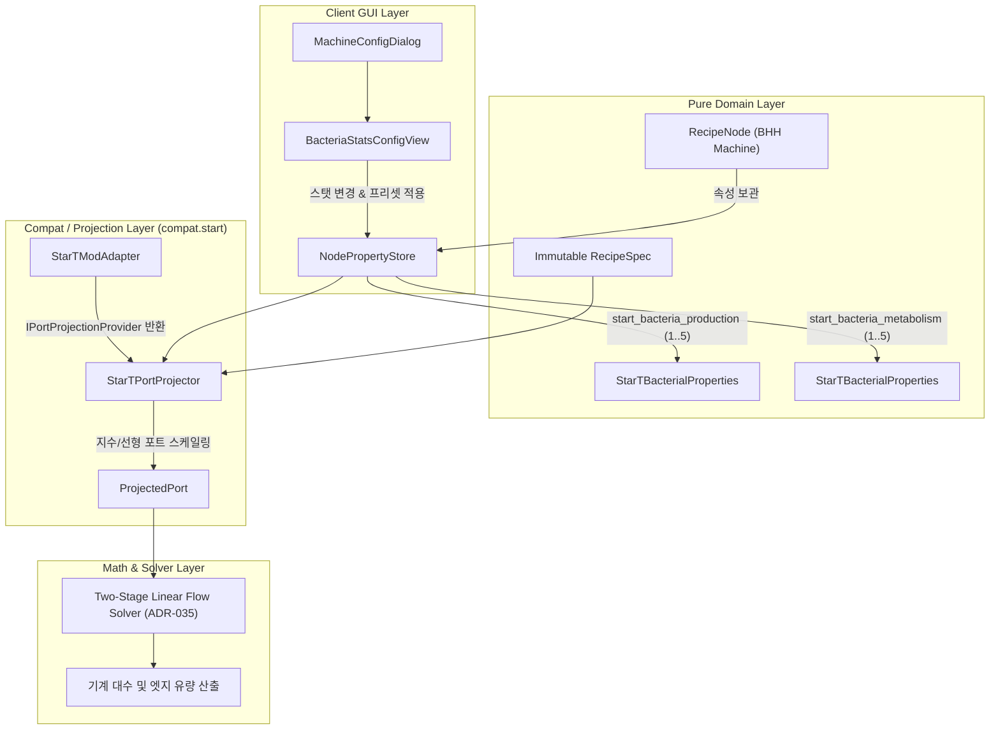

# ADR-067: Star Technology 박테리아 추출기 능력치(생산력·신진대사) 가변 모델링 및 공정 유량 수지 연동 명세
# (Star Technology Bacterial Hydrocarbon Harvester Variable Stats (Production & Metabolism) Modeling & Flow Balance Integration Specification)

- **문서 번호**: ADR-067
- **대상 버전**: `v2.4.3`
- **상태**: IMPLEMENTED
- **결정 일자**: 2026-10-18
- **주관 계층**: Compat (`compat.start`), Pure Domain (`api.property`, `api.model`), Client GUI (`client.gui.dialog.config`)
- **연관 사양서**: [01. 코어 도메인 모델](../../docs/ko_kr/spec/01_CORE_DOMAIN_AND_MODELS.md), [02. 수학 및 알고리즘](../../docs/ko_kr/spec/02_MATH_AND_ALGORITHMS.md), [05. 외부 모드 연동](../../docs/ko_kr/spec/05_INTEGRATION_AND_I18N.md)
- **선행 ADR**: [ADR-013](./ADR_013_MODULAR_COMBUSTION_COMPLEX_INTEGRATION.md), [ADR-029](./ADR_029_MOD_ADAPTER_INTERFACE_SEGREGATION_AND_EXTENSIONS.md), [ADR-050](./ADR_050_IMMUTABLE_RECIPE_SPEC_AND_DYNAMIC_PORT_PROJECTION.md)

---

## 1. 개요 및 배경 (Context & Motivation)

Star Technology 모드팩의 생명공학 추출 시설인 **박테리아 탄화수소 수확기(Bacterial Hydrocarbon Harvester, 이하 BHH)**는 투입되는 박테리아 군집 아이템의 스탯(생산력 및 신진대사)에 따라 자원 소모량과 생산량이 비선형적으로 변동하는 특수 설비입니다:
1. **생산력 (Production, 1~5)**: 1차, 2차, 3차 친화도 액체, 고유 초유체 및 박테리아 액체 생산량에 **선형 정비례**($\times \text{생산력}$).
2. **신진대사 (Metabolism, 1~5)**: 설탕 및 바이오매스 소모량에 **지수 비례**($2^{\text{신진대사}}$).

그러나 기존 레시피 변환 파이프라인에서는 JEI/EMI에 등록된 대표 레시피(Representative Recipe, 최대 능력치인 생산력 5, 신진대사 5 기준)만을 고정 수량으로 가져왔습니다. 이로 인해 실제 플레이어가 신진대사를 1로 육성한 종결 박테리아(회당 설탕 2개, 바이오매스 200 mB 소모)를 사용할 때, 보드 계산기 상에서는 설탕 32개, 바이오매스 3,200 mB로 계산되어 **실제 소비량 대비 정확히 16배(1,600%) 과다 계산**되는 문제가 발생했습니다.

본 결정은 BHH 노드에서 플레이어가 생산력(1~5)과 신진대사(1~5) 스탯을 직관적으로 설정하고, 원본 불변 레시피를 보존하면서 포트 투영 계층(ADR-050)을 통해 실시간 유량 수지를 재계산하는 아키텍처를 수립합니다.

---

## 2. 세부 설계 및 결정 사항 (Architecture Decision)

### 2.1 계층별 책임 분리 및 도메인 순수성 준수 (Rule 6)

1. **도메인 속성 격리 (`StarTBacterialProperties`)**:
   - `RecipeNode` 클래스에 모드 전용 필드를 추가하지 않고, `NodeProperties` 레지스트리를 통해 `BACTERIA_PRODUCTION`(기본값 5), `BACTERIA_METABOLISM`(기본값 5)을 선언했습니다.
   - 1~5 범위를 벗어나는 입력은 `clampStat`을 통해 엄격히 방어합니다.
2. **동적 포트 투영기 (`StarTPortProjector`)**:
   - `IPortProjectionProvider`를 구현하여 BHH 레시피 타입(`bacterial_hydrocarbon_harvester`) 노드의 입출력 포트를 계산 시점에 동적으로 투영합니다.
   - **설탕 소모량**: $2^{M}$ 개 (`1 << metabolism`)
   - **바이오매스 소모량**: $100 \times 2^{M}$ mB (`100 << metabolism`)
   - **산출 유체 (5종)**: $\text{BaseAmount} \times P$ mB ($P \in [1, 5]$)
   - 증류수(1,000 mB) 및 박테리아 아이템(1개)은 고정 수량을 유지합니다.
3. **UI 컴포넌트 (`BacteriaStatsConfigView` & `BacteriaStatsSection`)**:
   - **우측 인스펙터 직결 (`BacteriaStatsSection`)**: BHH 노드 선택 시 우측 인스펙터 패널에 박테리아 능력치 조작 섹션이 즉시 노출되어, 모달 창을 열지 않고도 생산력/신진대사 스텝퍼 및 3대 프리셋을 원클릭 조작할 수 있습니다.
   - **모달 설정 다이얼로그 (`BacteriaStatsConfigView`)**: `AddonCategory.BACTERIA_STATS`를 등록하고, BHH 노드 열람 시 기본 탭으로 활성화합니다.
   - 생산력 및 신진대사 스텝퍼 버튼(`[-]`, `[+]`) 및 블록 바 시각화(■■■□□)를 제공합니다.
   - **원클릭 프리셋 3종**:
     - `[★ 종결 박테리아 (5/1)]`: 소모량 1/16 절감 및 최대 생산량
     - `[JEI 기본값 (5/5)]`: 레시피 북 기준
     - `[초기 배양체 (1/5)]`: 야생 박테리아 기준
   - 사이클당 입출력 자원 실시간 미리보기를 제공하며, 변경 시 즉시 `node.syncProjectedPorts()` 및 상위 보드 유량 재계산을 트리거합니다.
4. **결정론적 레시피 타입 및 머신 연역 (`StarTReflectionBridge`, Rule 5 준수)**:
   - `path.equals(...)`와 같은 문자열 휴리스틱 매칭을 일체 배제하고, 클래스 로딩 시점에 `StarTRecipeTypes` 정적 필드를 리플렉션으로 읽어 공식 레시피 타입 식별자 세트(`START_RECIPE_TYPE_IDS`)를 1회 캐싱합니다.
   - `StarTModAdapter.handlesCategory` 및 `handlesNode`, `StarTPortProjector.isBacterialHarvester` 등 모든 판별 로직을 `StarTReflectionBridge`의 정규 `ResourceLocation` 전체 일치(`equals`, `Set.contains`)로 일원화하여 모드팩 커스텀 환경에서도 안전하게 동작합니다.

---

## 3. 결과 및 파급 효과 (Consequences)

### 3.1 긍정적 효과
* **16배 과다 계산 문제 해결**: 종결 박테리아(5/1) 적용 시 설탕과 바이오매스 소모량이 정확히 1/16로 축소 투영되어, 상위 사탕수수 농장 및 바이오매스 생산 라인의 오버헤드 없는 정확한 기계 대수 산출이 가능해졌습니다.
* **육성 단계별 자유로운 시뮬레이션**: 플레이어가 현재 보유한 박테리아의 임의 스탯(예: 3/2 등)에 맞춘 정확한 유량 수지를 설계할 수 있습니다.
* **기존 아키텍처 불변식 완벽 보존**: 원본 레시피 스펙(`RecipeSpec`)을 보존하는 ADR-050 동적 포트 투영 아키텍처를 준수하여 노드 복제, 템플릿 저장, NBT 영속화 시 데이터 유실이 발생하지 않습니다.

### 3.2 단위 테스트 검증 내역
* `StarTBacteriaHarvesterScalingTest`:
  - `testHarvesterDetection`: BHH 노드 판별 정상 통과.
  - `testDefaultStatsScaling`: 기본 스탯(5/5) 기준 설탕 32개, 바이오매스 3,200 mB, 산출 유체 7,500 mB 등 100% 일치.
  - `testPerfectStatsScaling`: 종결 스탯(5/1) 기준 설탕 2개(-93.8%), 바이오매스 200 mB(-93.8%) 1/16 축소 검증 통과.
  - `testIntermediateStatsScaling`: 중간 스탯(3/2) 기준 설탕 4개, 바이오매스 400 mB, 1차 4,500 mB 비례 검증 통과.
  - `testClampingAndDefense`: 음수 및 초과 스탯 입력 시 1..5 클램핑 방어 통과.
  - `testCopyPreservesStats`: 노드 복제 시 NBT 속성 및 투영 포트 보존 통과.
* **빌드 결과**: 전체 단위 테스트 스위트 100% `BUILD SUCCESSFUL` 통과.
